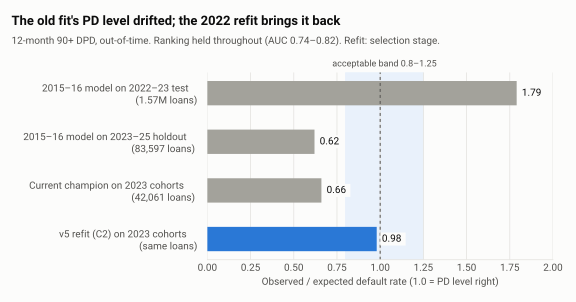
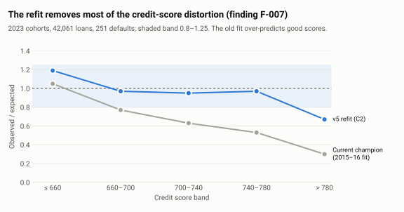
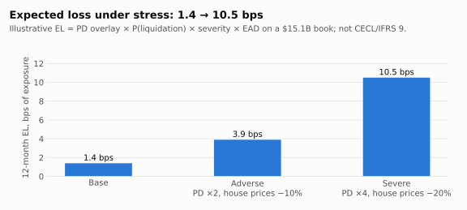
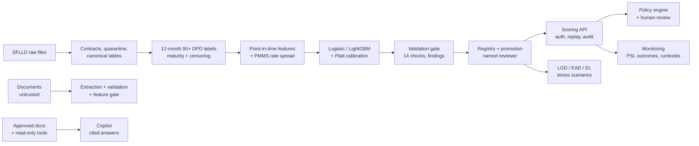

# credit-risk-ai-platform

[](https://github.com/Dzidefo123/credit-risk-ai-platform/actions/workflows/ci.yml)

An end-to-end, auditable **mortgage credit-risk system** built on the Freddie Mac Single-Family Loan-Level Dataset
(Release 47). It covers:

- an origination PD model;
- validation, a fairness review, a credit policy engine, portfolio monitoring, and LGD/EAD with stressed expected loss;
- document intelligence and an analyst copilot (an LLM with citations, guarded against prompt injection).

The model work rests on about 3.4M loans and 189M monthly performance records.

> Research prototype on public data: not a regulatory model, not production software, not a credit decision system.
> Results are aggregates only. Freddie Mac data is never in this repository.

**How the work was done.** Every modelling question was **pre-registered** (plan committed before any code or data
access), and test sets were **evaluated once**, with every access written to a hash-chained audit log. **Negative
results are reported as results.** Two PD-level fixes failed their pre-registered tests and were rejected. The
document-AI and copilot pipeline failed two quality criteria with a mock LLM. Both outcomes are documented next to
the successes.

## Results at a glance

| Question | Answer | Evidence |
|---|---|---|
| Does an origination scorecard rank risk years later? | **Yes.** AUC 0.815 on a fresh 2023–25 holdout, 7–10 years after the training cohorts | [holdout](docs/results/holdout_2023_2024.md) |
| Is its PD level stable? | **No.** Observed/expected ranges from 0.62 to 1.79 across periods; recalibration (v3) and TTC anchoring (v4) were both rejected | [v3](docs/results/recalibration_v3.md) · [v4](docs/results/ttc_level_v4.md) |
| Does refitting on 2022 originations fix it? | **Promising, not yet confirmed.** O/E 0.98 on 2023 cohorts; the confirmatory test waits for Release 48 | [v5](docs/results/model_refresh_v5.md) |
| Should geography be a feature? | **No.** `property_state` lowered out-of-time AUC (−0.012, CI excludes 0); removed | [fairness review](docs/results/fairness_review_v1.md) |
| What does stress do to expected loss? | 1.4 → 3.9 → 10.5 bps (base, adverse, severe) on a $15.1B book; illustrative, not CECL | [LGD/EL](docs/results/lgd_el_v1.md) |
| Can an LLM copilot answer only from evidence? | With Claude Sonnet 5.5: accuracy 0.73 on held-out questions, 100% permission and injection checks, 0 unsupported numbers, ≈ $0.94 for the whole evaluation | [document AI + copilot](docs/results/document_ai_copilot_v1.md) |

<picture>
  <source media="(prefers-color-scheme: dark)" srcset="docs/figures/level_drift_dark.svg">
  
</picture>

<picture>
  <source media="(prefers-color-scheme: dark)" srcset="docs/figures/credit_score_bands_dark.svg">
  
</picture>

<picture>
  <source media="(prefers-color-scheme: dark)" srcset="docs/figures/expected_loss_dark.svg">
  
</picture>

Figures are drawn from the aggregate numbers in `docs/results/` by [scripts/make_figures.py](scripts/make_figures.py).
The model is described in the [model card](docs/model_card.md).

## What is in the system



| Area | Highlights |
|---|---|
| Data | Versioned layouts for two releases; out-of-core DuckDB for 189M records; deduplication and reconciliation checks |
| Target | Research definition with cohort-level maturity, censoring codes and a disaster/forbearance sensitivity target |
| Models | Logistic and monotone LightGBM; time-ordered splits with purge gaps; bootstrap CIs; exact reason codes |
| Governance | Pre-registered plans; audited single test access; validation runner and findings register; promotion and rollback by a named reviewer |
| Serving | FastAPI with hashed API keys and 5 roles, idempotent scoring, replay from the audit record, Streamlit analyst UI |
| Policy & monitoring | Whitelisted YAML rule engine (PD rules blocked unless the model is approved for PD level), historical simulation, PSI drift and runbooks |
| Loss | P(liquidation \| default), severity model, EAD ratio and house-price stress; Release 47 loss reconciliation verified to 1e-11 |
| AI | Provider-neutral LLM adapter; grounded extraction with page/quote references; role filtering before retrieval; citation and number verifier |

## Run it

**Docker demo** (synthetic data, no credentials):

```bash
docker compose up --build        # first run about 5–10 minutes; prints demo API keys
```

Then open the UI at http://localhost:8501 and the API docs at http://localhost:8000/docs.

**Local development** needs Python 3.12 and [uv](https://docs.astral.sh/uv/):

```bash
uv sync
uv run pytest -q                                      # 100+ tests, synthetic data only
uv run crisk run-slice --dataset synthetic_fixture    # whole pipeline on fixtures (~45 s)
uv run crisk create-api-key --dataset synthetic_fixture --name me --role analyst
uv run crisk serve --dataset synthetic_fixture        # http://127.0.0.1:8000/docs
uv run --group ui streamlit run src/crisk/ui/app.py   # analyst UI
```

<details><summary>Real-data pipeline and other commands</summary>

Download the data under Freddie Mac's terms first (see [acquisition steps](docs/data_acquisition_freddie_mac.md)).

```bash
uv run crisk unpack          --dataset freddie_mac_historical
uv run crisk ingest          --dataset freddie_mac_sample          # also freddie_mac_historical
uv run crisk ingest          --dataset freddie_mac_combined        # composes validated files
uv run crisk build-canonical --dataset freddie_mac_combined
uv run crisk build-labels    --dataset freddie_mac_combined
uv run crisk build-features  --dataset freddie_mac_combined --feature-config configs/features/origination_v1_nostate.yaml
uv run crisk train           --dataset freddie_mac_combined --feature-config configs/features/origination_v1_nostate.yaml
uv run crisk evaluate-test   --dataset freddie_mac_combined --model-id <id>          # audited
uv run crisk validate        --dataset freddie_mac_combined --model-id <id> --validator <name>
uv run crisk promote         --dataset freddie_mac_combined --model-id <id> --reviewer <name> --rationale "<why>"
uv run crisk policy-simulate --dataset freddie_mac_combined --eval-dataset freddie_mac_holdout
uv run crisk monitor         --dataset freddie_mac_combined --eval-dataset freddie_mac_holdout
uv run crisk el-run          --dataset freddie_mac_combined --model-id <lgd_id> --holdout-dataset <lgd dataset> \
                             --eval-dataset freddie_mac_holdout --fpd-from 2024-04 --fpd-to 2025-03
uv run crisk copilot-ask     --dataset freddie_mac_combined --role analyst --question "What is the base scenario EL rate?"
uv run crisk export-results  --dataset freddie_mac_combined --model-id <ids>        # aggregate-only publication gate
```

Optional Claude backend for documents and the copilot: run `uv sync --group llm`, set `ANTHROPIC_API_KEY` in your
environment, and set `CRISK_LLM_PROVIDER=anthropic`. The default provider is a deterministic mock.
</details>

## Documentation

- [Project status](docs/PROJECT_STATUS.md) · [Decision log](docs/decision_log.md) · [Phase plan](docs/phase_plan.md) ·
  [Architecture](docs/architecture.md)
- [Model card](docs/model_card.md) · [Target specification](docs/target_specification.md) ·
  [Feature dictionary](docs/feature_dictionary.md) · [Assumptions register](docs/assumptions_register.md)
- Pre-registrations:
  - evaluation plans [v1](docs/evaluation_plan_v1.md), [v2](docs/evaluation_plan_v2.md),
    [v3](docs/evaluation_plan_v3.md), [v4](docs/evaluation_plan_v4.md) and [v5](docs/evaluation_plan_v5.md);
  - [fairness review](docs/fairness_review_plan_v1.md), [LGD/EL](docs/lgd_el_plan_v1.md) and
    [document AI + copilot](docs/document_ai_copilot_plan_v1.md).
- [Runbooks](docs/runbooks.md) · [Data handling and security](docs/data_handling_and_security.md)

## Evidence classes

| Label | Meaning |
|---|---|
| **EMPIRICAL** | Results on Freddie Mac SFLLD funded, acquired loans. Aggregates only. |
| **SYNTHETIC** | Fictional fixtures and documents (loan IDs start with `X`; every document page carries a banner). They test system behaviour, not credit risk. |

Every table, model artefact, score and API response carries `data_origin`.

## Data terms

Freddie Mac SFLLD data is used under Freddie Mac's terms for noncommercial research. Raw data, derived loan-level
data, model artefacts and audit stores are git-excluded and never redistributed. No attempt is made to identify
individuals. Source: <https://www.freddiemac.com/research/datasets/sf-loanlevel-dataset>.
